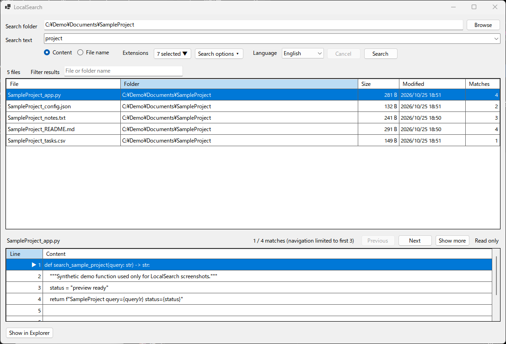
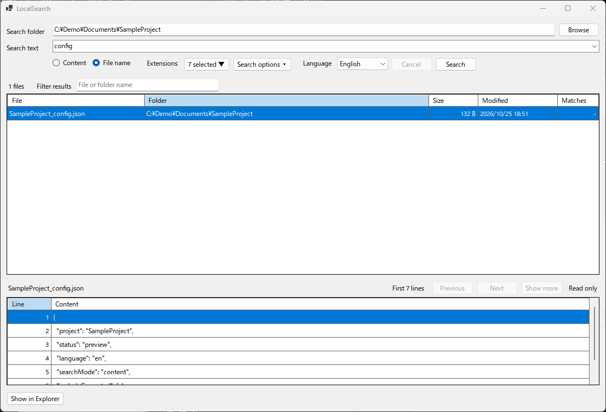

# LocalSearch

A simple Windows file search utility for file names and file contents.

## Features

- Search file contents with ripgrep
- Search file names with fd
- Filter by file extension
- Read-only file preview
- Japanese / English UI
- No indexing required
- Portable, self-contained Windows x64 build

## Download

Download the latest Preview release from the Releases page.

## Requirements

- Windows 10 / 11
- x64

## Notes

LocalSearch is currently a Preview release.

It is designed as a read-only search tool and does not delete, rename, move, or modify files.

## Feedback

Bug reports and usability feedback are welcome through GitHub Issues.

## Screenshots

### Content search

### File name search

